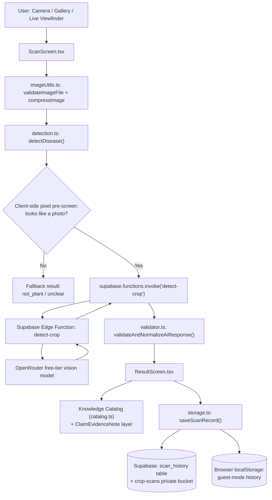

# HereForNature (PDDS) — Plant Disease Detection System

## Academic Project Report

---

### Title Page

| Field | Value |
|---|---|
| Project Title | HereForNature — AI-Assisted Plant Disease Detection System (PDDS) for Andhra Pradesh Agriculture |
| Student Name | **[STUDENT NAME — PLACEHOLDER]** |
| College / Institution | **[COLLEGE / INSTITUTION NAME — PLACEHOLDER]** |
| Department | **[DEPARTMENT — PLACEHOLDER]** |
| Guide / Supervisor | **[GUIDE NAME — PLACEHOLDER]** |
| Academic Year | **[ACADEMIC YEAR — PLACEHOLDER]** |
| Submitted By (Organization/Team, if applicable) | AgastyaOne Agriculture (project context) |
| Report Date | 2026-10-13 |

> This report was prepared from direct inspection of the project's source code, automated test output, and a local browser-driven run of the application in its development environment, as described in Section 13. Where a claim could not be verified this way, that limitation is stated explicitly rather than implied.

---

## 1. Abstract

HereForNature (internally referred to as PDDS — Plant Disease Detection System) is a React-based web application prototype that helps farmers in Andhra Pradesh identify common crop diseases and pests from a photograph and receive bilingual (English/Telugu) reference guidance drawn from a curated agricultural knowledge catalog. The application targets zero upfront AI inference cost by routing image analysis through a free-tier multimodal model via a server-side Supabase Edge Function, rather than a paid API. The system covers ten crop–condition pairs common to Andhra Pradesh agriculture, each backed by a structured knowledge entry describing symptoms, differential diagnoses, prevention practices, and treatment options, together with an explicit evidence-tracking mechanism that distinguishes supported guidance from guidance whose source could not be specifically verified. As of this report, the application passes 184 automated unit/data-flow tests and builds cleanly with TypeScript and Vite; the live, end-to-end AI inference path has been inspected and unit-tested with mocked responses, but has not been exercised against a live AI provider in this environment, and this is stated as an open item rather than claimed as working.

## 2. Introduction and Problem Statement

Smallholder farmers in Andhra Pradesh frequently lack timely access to expert agricultural diagnosis for crop diseases and pest damage, particularly in rural areas with limited extension-officer coverage. A farmer who notices unusual symptoms on a crop often has no fast way to determine whether the cause is an infectious disease, a pest, a nutrient deficiency, or ordinary environmental stress — a distinction that matters enormously, since treating a nutrient deficiency with a pesticide spray wastes money and can harm the crop further. HereForNature addresses this gap by letting a farmer photograph an affected leaf and receive: (a) a preliminary AI-assisted hypothesis about what might be wrong, and (b) bilingual, offline-available reference material — symptoms, lookalike conditions, prevention steps, and organic/chemical/preventive treatment options — for the ten crop conditions the project currently supports.

## 3. Project Objectives and Scope

**Objectives:**
- Provide a mobile-friendly web interface for photographing a crop and receiving a preliminary condition assessment.
- Maintain a curated, bilingual (English/Telugu) knowledge base for ten common Andhra Pradesh crop–condition pairs.
- Route AI inference through a free-tier provider with zero upfront cost, with the provider credential held server-side only.
- Treat agricultural safety as a first-class constraint: never present an unverified pesticide dose as a confirmed instruction.
- Allow a user to save scan history securely, whether as a guest (local-only) or as an authenticated user (private cloud storage).

**Scope:** The current implementation supports exactly ten crop–condition pairs (listed in Section 12). It does not attempt general-purpose plant identification, does not support crops or diseases outside this list, and does not perform any form of yield prediction, pricing, or marketplace functionality.

## 4. Existing-System Limitations and Proposed System

Generic plant-identification apps are typically trained on broad, global datasets and do not localize their advice to a specific state's extension-service guidance, nor do they distinguish a confidently-documented recommendation from a generic web citation. Many also assume continuous paid API access, which is not viable for a student/early-stage project or for cost-sensitive deployment to farmers.

PDDS's proposed approach: (1) a small, deliberately-scoped knowledge catalog curated around Andhra Pradesh's major crops, rather than an open-ended global catalog; (2) a free-tier AI gateway architecture so the live inference path never requires a paid key to operate; (3) an explicit, code-enforced evidence-tracking layer (described in Section 12) that flags which specific claims — not just which diseases — have adequate supporting documentation, so the UI never implies more certainty than the underlying data actually supports.

## 5. Requirements and Constraints

- **Functional:** image capture/upload, client-side image validation, AI-assisted preliminary diagnosis, bilingual knowledge display, scan history (guest and authenticated), language toggle.
- **Non-functional / project constraints:**
  - **Zero upfront AI cost:** the architecture must not require a paid AI subscription or credits to run; it uses OpenRouter's free-tier model routing, with the key held only in the server-side Supabase Edge Function environment, never in client-side code or a `VITE_*` environment variable.
  - No fabricated diagnoses, confidence scores, or agricultural claims — unverifiable chemical doses must be withheld from the user rather than guessed.
  - Private user data (scan images, scan history) must be isolated per authenticated user.
  - The system must degrade safely offline or when the AI provider is unavailable, rather than presenting a stale or fabricated result as current.

## 6. System Architecture and Data Flow

The Edge Function is the only part of the system that holds the AI provider's API key; it is never exposed to the browser. If the Edge Function or the provider is unreachable, `detectDisease()` returns a `provider_unavailable` result rather than fabricating a diagnosis — this fallback path is exercised by automated tests (Section 13) and was also observed in the local run described in Section 13's browser-level checks via the explicit demonstration-sample path, which never calls the Edge Function at all.

## 7. Technology Stack

Verified directly from `package.json` and the Supabase project files in this repository:

| Layer | Technology | Version (as pinned in the repo) |
|---|---|---|
| UI framework | React | 19.2.3 |
| Build tool / dev server | Vite | ^6.0.7 |
| Language | TypeScript | ^5.7.2 |
| Backend-as-a-service | Supabase (`@supabase/supabase-js`) | ^2.109.0 |
| Serverless compute | Supabase Edge Functions (Deno runtime) | — |
| AI inference (free tier) | OpenRouter API, model `dots-studio/dots-3-note-preview:free` (configurable via `OPENROUTER_MODEL`) | — |
| Testing | Vitest | ^5.0.3 |
| Styling | Plain CSS (`App.css`) | — |
| Target platform | Mobile and desktop web browsers (no native/Expo build in this codebase) | — |

No `@testing-library`/component-rendering test harness is present in this project (confirmed by inspecting `package.json` and the test files) — automated UI-logic tests are data-flow/predicate tests against real exported functions and the real catalog, not rendered-DOM tests. A separate local browser-driven run (Section 13) covers what those unit tests cannot.

## 8. Main Modules and Responsibilities

| Module | Responsibility |
|---|---|
| `src/screens/ScanScreen.tsx` | Image capture (camera/gallery/live viewfinder), client-side validation before dispatch |
| `src/lib/imageUtils.ts` | File-type and file-size validation (rejects non-image files and files over 10 MB), client-side compression |
| `src/lib/detection.ts` | Orchestrates detection: demo-sample short-circuit, pixel pre-screen, Edge Function dispatch, safe fallback |
| `supabase/functions/detect-crop/index.ts` | Server-side AI gateway: holds the provider key, validates the request, calls OpenRouter, returns structured JSON or a typed error |
| `src/lib/ai/validator.ts` | Normalizes and validates raw model output against the real crop/disease registry; never lets an unrecognized ID through as a "supported" diagnosis |
| `src/lib/ai/openrouterAdapter.ts` | Server-side/test-only adapter class (isolated this sprint — see Section 14) used for isolated testing of the request/response/validation shape |
| `src/lib/knowledge/catalog.ts` + `types.ts` + `service.ts` | The curated bilingual knowledge base and its evidence-tracking helpers |
| `src/screens/ResultScreen.tsx` | Renders diagnosis, knowledge-base content, and all evidence/suppression disclosures |
| `src/lib/storage.ts` + `src/lib/auth.ts` | Scan persistence (cloud and local), account isolation, rollback on failure |
| `src/lib/i18n.ts` + `src/contexts/LanguageContext.tsx` | English/Telugu translation dictionary and language-switch context |

## 9. Database, Authentication, Image Storage, and Privacy Design

The Supabase schema (`supabase/migrations/`) defines a `scan_history` table and a private `crop-scans` storage bucket. Row-Level Security policies (`002_secure_scan_history_rls.sql`, `003_secure_storage_bucket.sql`) restrict every table operation and every storage object to `auth.uid()`-scoped ownership — a user can only read, write, or delete their own records and their own folder (`{auth.uid()}/...`) in the bucket. Guest (unauthenticated) users never have their scans written to the cloud: `getLocalUserId()` in `src/lib/auth.ts` generates a browser-local guest ID that is explicitly documented as "NEVER passed to Supabase cloud database," and `saveScanRecord()` in `src/lib/storage.ts` keeps unauthenticated scans in `localStorage` only. Switching accounts triggers cache/history cleanup for the previous user (`onAuthStateChange` handling in `auth.ts`) to prevent cross-account data leakage on a shared device. Image URLs for private scans are resolved to short-lived (1-hour) signed URLs rather than public links.

**Important limitation:** this design was verified by reading the migration SQL and the application code; it has **not** been exercised against a live, connected Supabase project in this environment (no live project credentials were available), so RLS enforcement and storage-policy enforcement are not claimed as live-tested — only as correctly specified in code.

## 10. AI Inference Pipeline and Validation Logic

1. The client performs a fast, local pixel-buffer check (`evaluatePixelBuffer` in `detection.ts`) to reject obviously blank, transparent, or flat-color (non-photographic) inputs before any network call — this check explicitly never uses color/greenness as a criterion, so necrotic brown, chlorotic yellow, or white cotton-boll imagery is never rejected for its color.
2. The image is dispatched to the `detect-crop` Supabase Edge Function, which holds the OpenRouter API key server-side and enforces: caller-auth-header presence, payload size limit (4 MB), a bounded 18-second timeout, and typed error responses for rate-limiting (429), upstream failure, malformed JSON, and empty responses.
3. The raw model JSON is passed through `validateAndNormalizeAiResponse()`, which: rejects non-object/malformed payloads into an `'uncertain'` status rather than guessing; overrides any claimed diagnosis to `'unusable_image'` if the model itself flags the image as unassessable; and — critically — cross-checks any claimed crop/disease ID against the real supported registry, downgrading to `'unsupported_crop'`/`'unsupported_disease'` if the model names something outside the catalog, so a hallucinated ID can never silently reach the UI as if it were catalog-backed.
4. The normalized result carries a `diagnosticTier` (`demonstration_sample`, `ai_preliminary_hypothesis`, or `legacy_or_unknown`) that the UI always displays alongside the result, so a user can never mistake a demo preview or a legacy/un-tagged record for a fresh live analysis. No numeric AI confidence score is ever surfaced to the user as a "validated diagnostic probability" — the schema does not expose one.

**Status of this pipeline:** inspected end-to-end and unit-tested against mocked HTTP responses (`src/lib/ai/__tests__/validator.test.ts`, `openrouterAdapter.test.ts`). **Live inference against the real OpenRouter provider has not been exercised in this environment** — no provider credentials were available or purchased for this project at the time of writing. This is the single largest unverified claim in the system and is listed as the top follow-up item in Section 15.

## 11. Crop-Condition Knowledge Catalog and Evidence Handling

The catalog (`src/lib/knowledge/catalog.ts`) currently covers exactly ten crop–condition pairs: Rice Blast, Chilli Leaf Curl Virus, Cotton Pink Bollworm, Groundnut Tikka (Leaf Spot), Maize Fall Armyworm, Sugarcane Red Rot, Tomato Early Blight, Mango Anthracnose, Banana Panama Wilt, and Turmeric Rhizome Rot. Each entry includes bilingual symptoms, pathogen/pest identity, differential ("lookalike") conditions distinguishing it from similar-looking pathological and abiotic issues, environmental risk factors, prevention guidance, organic/chemical/preventive treatment options, an escalation threshold, and a list of cited sources.

**Evidence status, as of this report (computed directly from the catalog data, not estimated):**
- 10 disease entries total; 9 carry `evidenceStatus: 'unverified'`, 1 (Banana Panama Wilt) carries `'conflicting'`; **none** currently carry `'verified_reference'`.
- 23 total cited sources across the catalog; **0** of them are linked to a specific document page/section — every citation currently links only to an organization's homepage, and the catalog's own `isSourceDocumentVerified()` predicate (and its regression tests) enforce that this is surfaced to the user as a disclosure rather than presented as a verified citation.
- Every chemical product name and dose figure in the catalog that could be acted on directly is paired with explicit suppression language directing the user to confirm with a Village Agriculture Assistant (VAA) or Rythu Bharosa Kendra (RBK) rather than presenting it as a usable instruction — this invariant is enforced by automated tests and was re-confirmed by a full programmatic scan of the catalog during this project's development.
- A **claim-level evidence layer** (`ClaimEvidenceNote`, added to the type system and catalog this sprint) additionally flags two specific numeric figures — Groundnut Tikka's spray water volume and Banana Panama Wilt's lime-per-pit quantity — as `'unsupported'` at the level of that one specific claim, independent of the disease's overall `evidenceStatus`. This closes a gap where a disease-wide status could, in principle, have implied a numeric figure was more supported than it actually was. The UI renders this as an "Evidence Note" directly beneath the relevant text; this was confirmed both by automated tests and by direct visual inspection in a running browser session (Section 13).

**The catalog is not, and is not claimed to be, scientifically or agronomically verified.** Its evidence-status fields and the newer claim-level notes exist specifically to make that limitation visible to the user rather than to assert the opposite.

## 12. Testing Methodology and Actual Results

Three distinct levels of testing were performed, and are reported separately rather than conflated:

1. **Automated unit / data-flow tests** (`npx vitest run`): **184 tests passed, 0 failed**, across 10 test files, exit code 0. These test real exported functions against real data (the catalog, the validator, the storage/auth logic) — they are not rendered-DOM/component tests, since no such harness exists in this project.
2. **TypeScript + production build** (`npm run build`, i.e. `tsc && vite build`): succeeds with exit code 0. The only warning is a pre-existing bundle-size notice (>500 kB after minification) — a packaging observation, not a functional defect, and left unaddressed intentionally to avoid a risky late-stage rewrite.
3. **Local browser-driven verification**: the Vite dev server was started locally and driven with a headless Chromium instance (Playwright) in this development environment. The following were **passed through actual execution**, confirmed by live DOM assertions and, for two key checks, by a human-reviewed screenshot:
   - Application starts and the Home screen renders.
   - The Scan screen renders with its upload options.
   - An invalid (non-image) file selected via the upload input is rejected with the expected message.
   - An oversized (>10 MB) file is rejected with the expected message.
   - The explicitly-labeled demonstration/sample path completes and displays a "Demonstration Sample — Illustrative Preview Only. Not a live field diagnosis" banner, visibly distinct from a live-inference result.
   - The Groundnut Tikka Chemical tab displays the new Evidence Note directly beneath the safety caution (confirmed in English and in Telugu, and by a screenshot).
   - The Banana Panama Wilt escalation card displays the new Evidence Note (confirmed in English and in Telugu).
   - The language toggle switches the whole application to Telugu and all of the above re-render correctly in Telugu.
   - Zero browser console errors were recorded across the entire run.

   **Not tested in this environment:** live AI inference against a real provider; a connected live Supabase project (authentication, RLS enforcement, storage policy enforcement); any multi-user or concurrent-access scenario; performance/load testing; cross-browser/cross-device testing beyond the single headless Chromium session described above.

## 13. Security and Safety Considerations

- The AI provider credential is read only from a server-side Supabase Edge Function environment variable (`Deno.env.get('OPENROUTER_API_KEY')`); a repository-wide search confirms no `import.meta.env` (Vite client-side) usage ever reads an AI provider key — only the public Supabase URL and anon key, which are designed to be public and are enforced by RLS, not secrecy.
- An unused, fully-functional client-callable `OpenRouterAdapter` class existed in the codebase as test-support scaffolding; while never wired into the live application flow, it represented a latent risk if ever instantiated with a client-exposed key. This sprint added a runtime guard that makes the class throw immediately if constructed in a browser context, plus a prominent code comment, with a passing regression test for the guard itself (see Section 14).
- Database and storage access control (RLS, private bucket, owner-scoped signed URLs) is specified in the migration SQL and was reviewed by direct inspection; it has not been exercised against a live project (see Section 9/12's stated limitation).
- No unverified actionable chemical dose remains in the live user-facing catalog content, per the automated and manual scans described in Section 11.

## 14. Current Limitations

- **Live AI inference is unverified.** This is the most significant open item; the pipeline is implemented and unit-tested with mocks, but has not produced a real result from a real provider in this environment.
- **No live Supabase integration test.** Security/storage design has been code-reviewed, not live-tested.
- **Agricultural evidence is explicitly incomplete.** Zero catalog sources are claim-specific-verified; two numeric claims carry an explicit "unsupported" evidence note; the rest of the catalog's numeric/factual claims have not yet been migrated onto the same claim-level evidence mechanism.
- **Small catalog scope.** Exactly ten crop–condition pairs; no broader crop or disease coverage.
- **No automated component/browser test suite is wired into CI** — the manual Playwright run described in Section 12 was performed ad hoc in this session, not as a repeatable, committed test script.
- **Bundle size** exceeds Vite's default 500 kB warning threshold; not addressed, as it is a non-blocking packaging concern.

Given all of the above, this project should be described as a **working prototype**, not a production-ready or clinically/scientifically validated system.

## 15. Future Enhancements

1. Obtain and configure a real (free-tier) OpenRouter credential to complete live end-to-end verification of the inference path.
2. Provision a live Supabase project for integration testing of RLS, storage policies, and authentication flows.
3. Extend the `ClaimEvidenceNote` mechanism to cover more of the catalog's numeric and factual claims, and pursue primary-source (CIBRC label, specific ANGRAU/ICAR bulletin page) verification where feasible.
4. Add a component-rendering test harness (e.g. React Testing Library) to allow automated UI-rendering assertions rather than relying solely on data-flow tests and ad hoc manual browser runs.
5. Expand crop/disease coverage within the same evidence-integrity standard, rather than adding breadth before the verification pipeline for existing entries is more complete.
6. Address the production bundle-size warning via code-splitting if/when the application grows further.

## 16. Conclusion

HereForNature/PDDS demonstrates a working, zero-upfront-cost architecture for AI-assisted crop disease triage aimed at Andhra Pradesh farmers, combining a free-tier AI gateway with a curated bilingual knowledge base and a deliberately conservative, code-enforced approach to agricultural evidence integrity. Automated testing (184 passing tests) and a direct local browser run confirm that the application's core user-facing flows — image validation, the demonstration path, bilingual rendering, and the newly added evidence-disclosure UI — work as implemented. The project's main remaining gap is live-provider and live-database integration testing, which requires external credentials not available in this development environment; this report states that gap explicitly rather than asserting a level of verification that was not actually performed.

## 17. References and Documentation Consulted

- Project source code and test suite, `pdds` repository, branch `claude/gallant-knuth-tz90q8` (this report was generated by direct inspection of this repository's own files; no external documentation was fetched for this report).
- `AGENTS.md` / `CLAUDE.md` — project architecture notes (React 19 + Vite 6, Supabase backend, target platforms: mobile and desktop web browsers).
- `package.json` — dependency and script listing.
- `supabase/migrations/*.sql` — database schema and Row-Level Security policy definitions.
- Automated test output: `npx vitest run` (184/184 passing) and `npm run build` (`tsc && vite build`, exit code 0), both executed during preparation of this report.
- A local Playwright-driven browser session against the project's own `vite` dev server, executed during preparation of this report (Section 12).

> Agricultural claims inside the application's own knowledge catalog cite ANGRAU, ICAR, and CIBRC as organizations, but — as stated in Section 11 — none of these citations has been verified by this project team against a specific document page or section. This report does not independently cite or vouch for any external agricultural publication beyond what is already recorded (and explicitly flagged as unverified) inside the repository.
